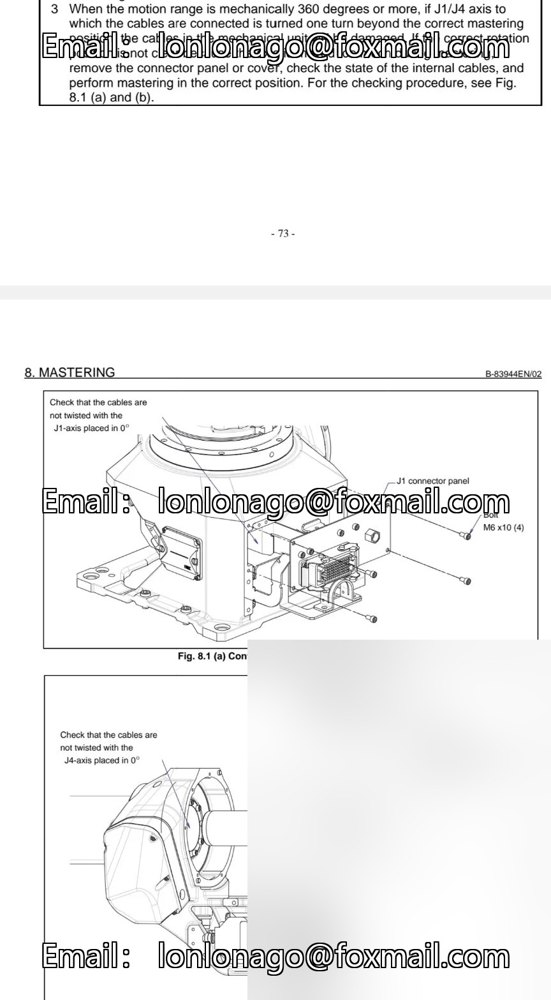
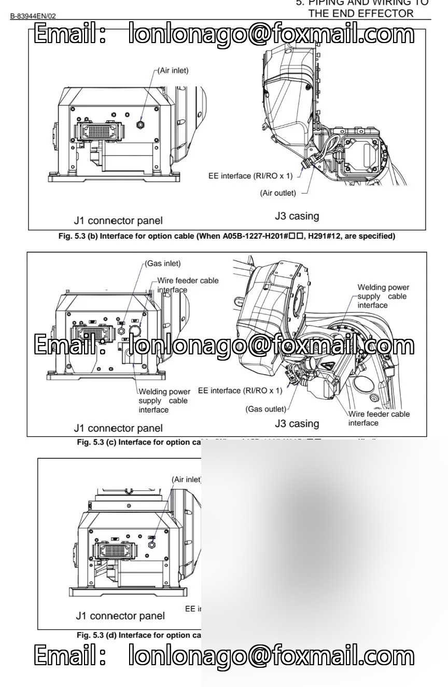
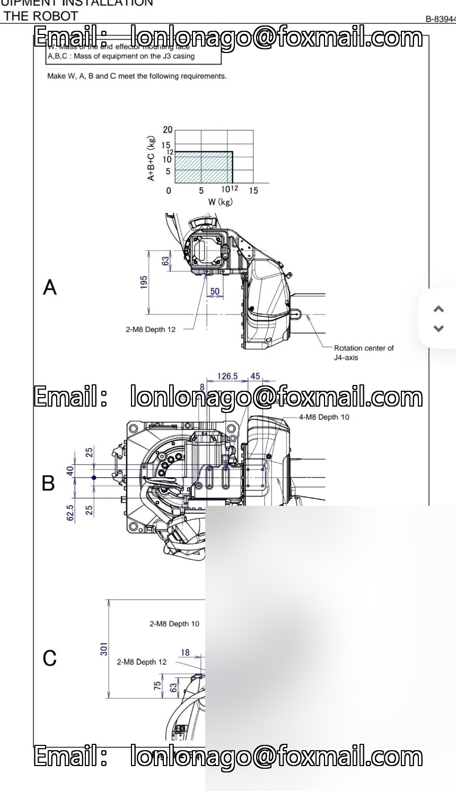
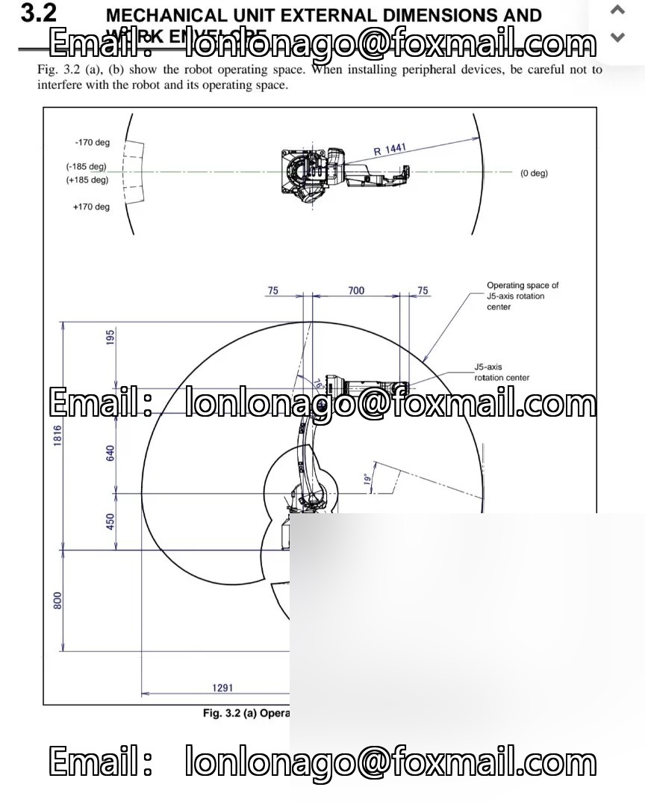
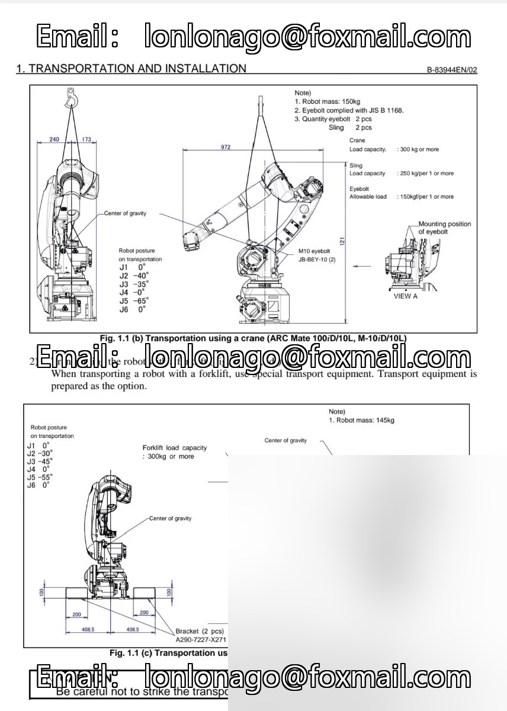

# FANUC (FAWUKE) ARC Mate 100iD / M-1

## Body

FANUC (FDCA) ARC Mate 100iD / M-10iD Robot Mechanical Unit Operation Manual
PDF , 120 pages, covers detailed descriptions of operation, installation, and maintenance of the ARC Mate 100iD and M-10iD model mechanical units, suitable for repair, programming, and technical reference.
9922

The manual covers FANUC (FANUC) ARC Mate 100iD / M-10iD robot mechanical unit operations, installation and maintenance, including 360-degree motion range and axis/connector checks.

<!-- AI_ENRICHED -->

## Images

## Payment

Here is a pay link on Stripe ( https://buy.stripe.com/3cs8yP7sY87d0vu9AB ). Please contact me lonlonago@foxmail.com after funding $89, and I will send you a complete data files , thank you!

